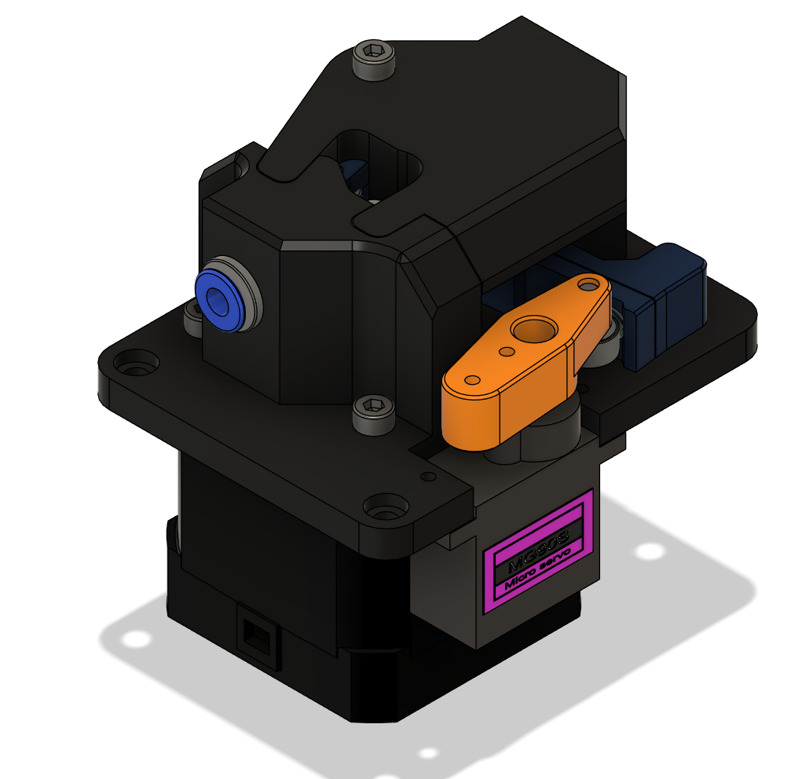
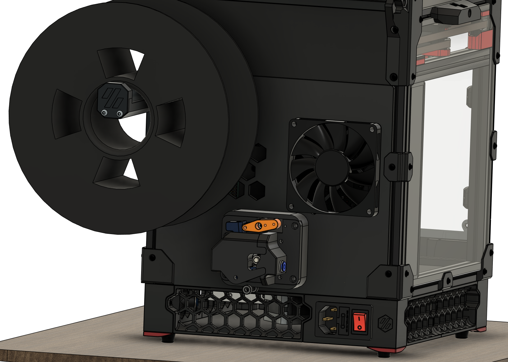
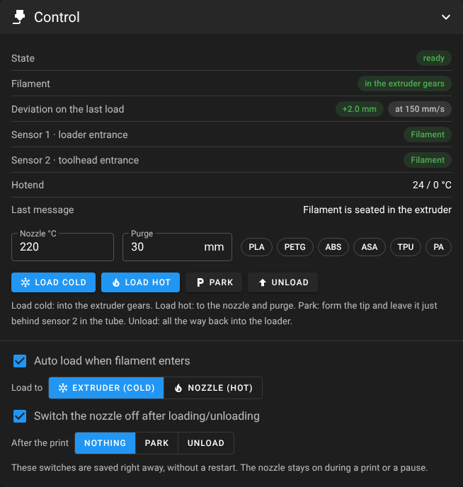
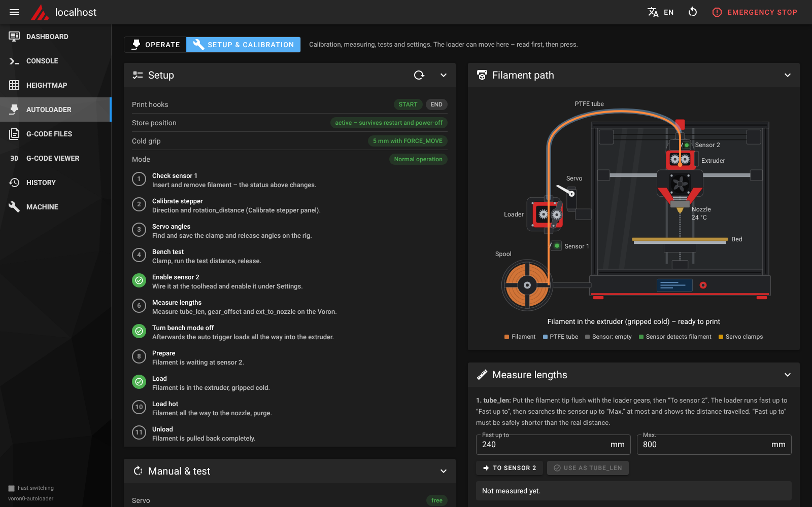

# Voron0-AutoLoader

> [!NOTE]
> **Written by Claude Opus 5.5** (Anthropic's AI model) – macros, installer, web UI and docs. Review the macros and
> watch the first runs with a hand on the emergency stop.

**Automatic filament loader for the Voron V0.2** – Klipper macros, a one-command installer and a Mainsail page.

[](LICENSE)


| Filament Feeder | Mounted to V0 |
|---|---|
|  |  |

**[Assembly guide](docs/assembly.md)** (mostly complete) · **[How it works](docs/how-it-works.md)** (details, all macros and settings)

A NEMA17 with BMG gears pushes the filament through a PTFE tube into the toolhead; an MG90S servo clamps the idler
only while the loader feeds. Two NC switches (loader entrance, above the extruder gears) tell Klipper where the
filament is.


## Features

- **Prepare** (to the toolhead, still removable by hand) · **Load** (into the extruder, cold) · **Load hot** (to the nozzle + purge)
- **Park / unload** – heats only if the filament is in the nozzle, with tip forming
- Position survives restarts and power-off, checked against the sensors at start-up
- 150 mm/s, slip check, auto load on insert, print start/end hooks
- Mainsail page with *Operate* and *Setup & calibration* mode, English / German, updates via Moonraker

## Screenshots

| Control | Setup & calibration | Settings |
|---|---|---|
|  |  |  |
| **Manual & test** | **Measuring** | **Lengths** |
|  |  |  |

## Hardware

Inspired by **[fila_feeder](https://github.com/DarkK9Design/fila_feeder)** by DarkK9Design.

| Function | Part | Default pin |
|---|---|---|
| Stepper | NEMA17 + BMG gears, **E0** driver of the SKR Pico (TMC2209) | `gpio14` / `!gpio13` / `!gpio15`, UART addr. 3 |
| Servo | MG90S | `gpio29` (SERVOS header) |
| Sensor 1 | micro switch at the loader entrance, NC | `^gpio16` (E0-STOP) |
| Sensor 2 | micro switch at the toolhead entrance, NC | `^nhk:gpio12` (Nitehawk-SB) |

Tested: Voron V0.2, SKR Pico, Nitehawk-SB, BTT Pi, Dragon Burner with Sherpa Mini and Dragon HF.
All pins can be changed in the installer or on the page.

## Installation

Needs Klipper, Moonraker and Mainsail (`[respond]` / `[pause_resume]` from `mainsail.cfg`).

```bash
cd ~ && git clone https://github.com/Screase3D/Voron0-AutoLoader.git
cd Voron0-AutoLoader
./install.sh --dry-run     # show what would happen
./install.sh               # install (no sudo – it asks itself where needed)
```

The installer backs up your config, installs the macros and the small Klipper module `autoloader_sync`, creates
`filament_loader_settings.cfg` (never overwritten) and adds – on request – the print hooks, the Mainsail page, the
update manager entry and the KlipperScreen menu. All options: `./install.sh --help`.

**Update:** Mainsail → *Update Manager* → `voron0-autoloader` (run `./install.sh` again if the page asks for it).
**Uninstall:** `./uninstall.sh` – the settings file is kept.

## First setup

On the page: **Setup & calibration**, then follow the checklist:

1. Sensor 1, servo angles, `rotation_distance`
2. Bench test (bench mode on)
3. Mount on the printer, enable sensor 2
4. Measure `tube_len`, `gear_offset`, `ext_to_nozzle`
5. Form a test tip, bench mode off, then prepare → load → load hot → park → unload

## Macros

| Macro | Purpose |
|---|---|
| `FILAMENT_PREPARE` | up to sensor 2 |
| `FILAMENT_LOAD_COLD` / `FILAMENT_LOAD TEMP=` | into the extruder / to the nozzle |
| `FILAMENT_PARK` / `FILAMENT_UNLOAD` | park in the tube / unload into the loader |
| `LOAD_FILAMENT` / `UNLOAD_FILAMENT` | Mainsail / KlipperScreen buttons |
| `LOADER_PRINT_START` / `LOADER_PRINT_END` | print hooks (after `M109` / before `TURN_OFF_HEATERS`) |
| `LOADER_STATUS` / `LOADER_RESET CONFIRM=1` | show the position / reset after a clog |

All macros and settings: [How it works](docs/how-it-works.md).

## Troubleshooting

- **Sensor shows filament with nothing inserted** – wiring (NC: a broken wire reads as "filament")
- **Loader runs backwards** – invert `dir_pin`
- **Timeout before sensor 2** – measure `tube_len`, check friction in the tube
- **Deviation warning** – lower `accel` / `speed`, check the clamp angle ([details](docs/how-it-works.md))
- **Filament stuck after unloading** – tune the tip forming
- **"autoloader_sync is missing"** – run `./install.sh` once via SSH (updates don't run the installer)
- **Page not reachable** – `sudo nginx -t`, and `chmod o+x ~`

## Credits

| Project | Author | Relation |
|---|---|---|
| [Claude](https://www.anthropic.com/claude) (Opus 5.5) | Anthropic | wrote the code and documentation |
| [fila_feeder](https://github.com/DarkK9Design/fila_feeder) | DarkK9Design | inspiration for the loader hardware |
| [VoronV0-Zeroclick-Mainsail-UI](https://github.com/Screase3D/voronv0-zeroclick-mainsail-ui) | Screase3D | installer and page shell are based on it |
| [Happy Hare](https://github.com/moggieuk/Happy-Hare) / [ERCF](https://github.com/Enraged-Rabbit-Community/ERCF_v2) | moggieuk / Enraged Rabbit Community | tip-forming sequence and defaults |
| [Voron V0](https://github.com/VoronDesign/Voron-0) | Voron Design | the printer |
| [Klipper](https://github.com/Klipper3d/klipper), [Moonraker](https://github.com/Arksine/moonraker), [Mainsail](https://github.com/mainsail-crew/mainsail) | their authors and contributors | firmware, API, web interface |
| [Material Design Icons](https://pictogrammers.com/library/mdi/) | Pictogrammers | icons |

Not affiliated with or endorsed by any of the projects above.

## License

GPL-3.0-or-later – see [LICENSE](LICENSE). Details in [THIRD_PARTY_NOTICES.md](THIRD_PARTY_NOTICES.md).
