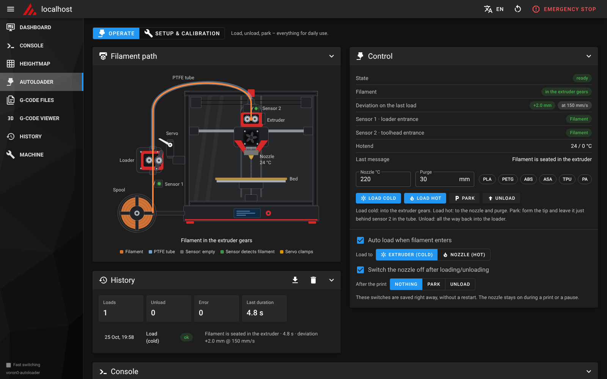
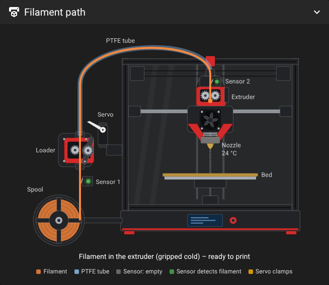
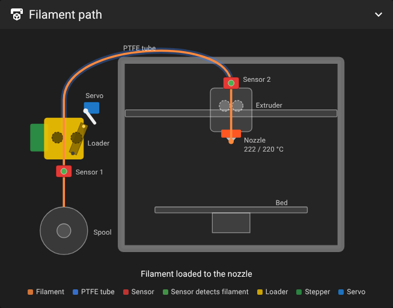
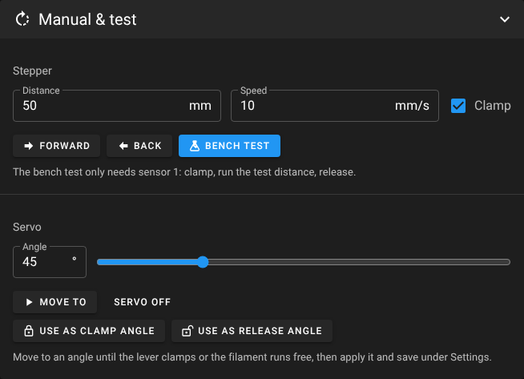
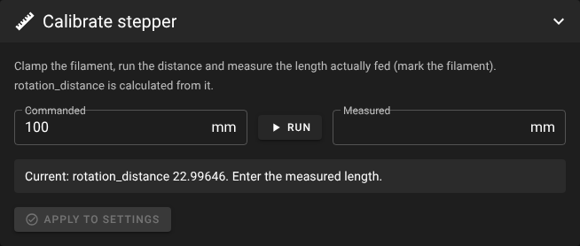
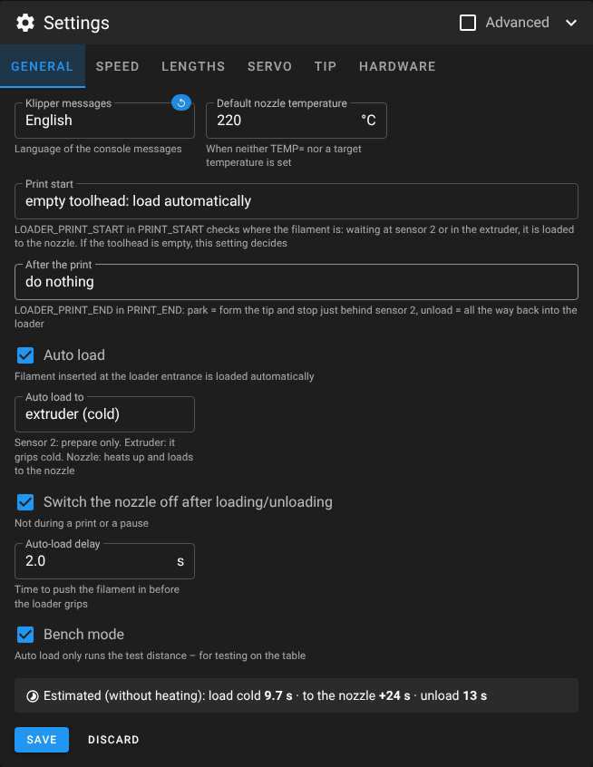
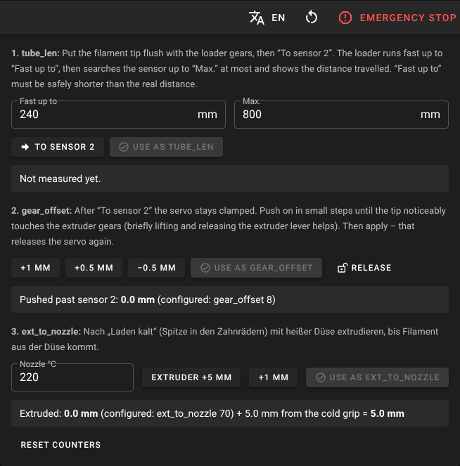
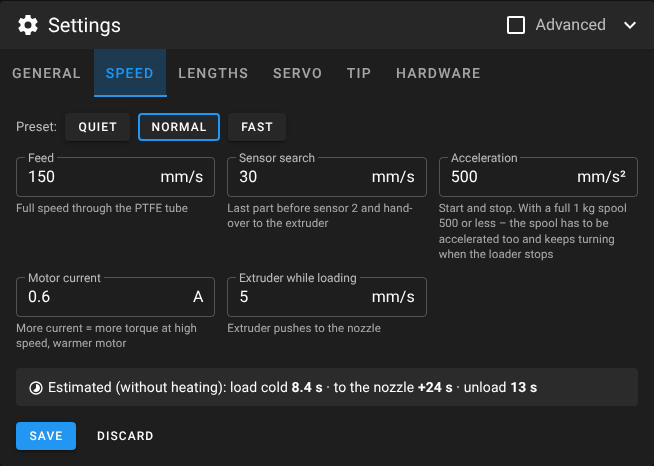
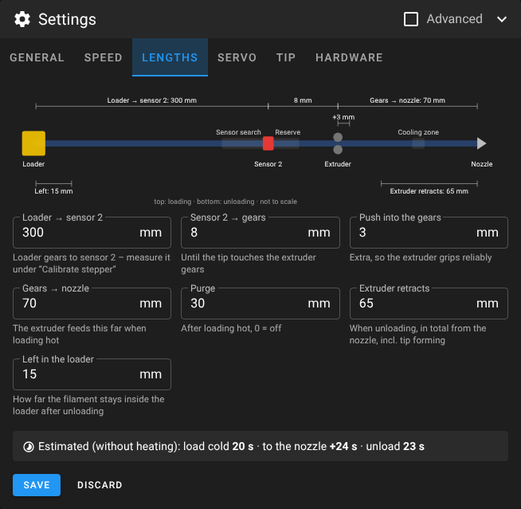

# Voron0-AutoLoader

Automatic filament loader for the **Voron V0.2** – Klipper macros, a one-command installer and a
Mainsail page that shows where the filament is.

A small loader with BMG gears and a NEMA17 sits next to the printer and pushes the filament through a
PTFE tube into the toolhead. An MG90S servo presses the idler gear onto the filament while the loader
is feeding and lets go afterwards, so the loader never fights the extruder. Two normally closed micro
switches tell Klipper where the filament is: one at the loader entrance, one directly in front of the
extruder gears in the toolhead.



## Features

- **Load cold** – feeds the filament from the loader through the tube into the extruder gears.
  The hotend can stay cold.
- **Load hot** – heats the hotend, loads (if needed), extrudes to the nozzle and purges.
- **Unload with tip forming** – heats, shapes a clean filament tip (ramming, break-off, cooling moves –
  the same approach as ERCF / Happy Hare), then the loader pulls the filament back out of the toolhead.
- **Mainsail / KlipperScreen buttons** – `LOAD_FILAMENT` and `UNLOAD_FILAMENT` use the loader.
- **Print hooks** – `PRINT_START` loads automatically when the toolhead is empty; optional unload in `PRINT_END`.
- **Auto trigger** – push filament into the loader entrance and it gets loaded on its own –
  into the extruder gears (cold) or all the way to the nozzle (hot), selectable on the page.
- **Nozzle off afterwards** – after loading/unloading the nozzle is switched off (not during a print or pause).
- **Bench mode** – the auto trigger only clamps, runs a test distance and releases. Safe for testing
  the loader on the table before it is mounted.
- **Mainsail page** with a live drawing of the filament path, status, setup checklist, manual tests,
  servo-angle and `rotation_distance` calibration, a helper to measure the lengths, history and a settings editor
  with plain-language fields, speed presets, a sketch of all lengths and a time estimate.
- **Fast** – full speed (150 mm/s by default, presets up to 250 mm/s) through the tube, the sensor is
  only searched on the last few centimetres.
- **KlipperScreen menu** (More → AutoLoader).
- German and English – UI, installer and Klipper messages.
- Updates through Moonraker's update manager.

## Screenshots

| Feeding through the tube | Loaded to the nozzle |
|---|---|
|  |  |

| Manual & test | Stepper calibration | Settings |
|---|---|---|
|  |  |  |

| Measuring the lengths | Speed presets | Lengths sketch |
|---|---|---|
|  |  |  |

## Hardware

| Part | Notes |
|---|---|
| Printer | Voron V0.2 with BTT SKR Pico V1.0, Nitehawk-SB toolhead board, BTT Pi / CB1 |
| Toolhead | e.g. Dragon Burner V0 with FYSETC CNC Sherpa Mini and Phaetus Dragon HF (the tip-forming defaults start here) |
| Loader | BMG-style dual gear drive (drive gear on the stepper, idler gear on a swing arm) |
| Stepper | NEMA17 on the free **E0** driver of the SKR Pico (TMC2209, UART) |
| Servo | MG90S, presses the idler arm |
| Sensor 1 | micro switch at the loader entrance, normally closed (NC) |
| Sensor 2 | micro switch at the toolhead entrance, a few mm above the extruder gears, NC |
| PTFE tube | loader → toolhead, about 300 mm |

### Default wiring

| Function | Board | Header | Pin |
|---|---|---|---|
| Stepper step / dir / enable | SKR Pico | E0 driver | `gpio14` / `!gpio13` / `!gpio15` |
| TMC2209 UART | SKR Pico | shared UART | `gpio9` / `gpio8`, address 3 |
| Servo signal | SKR Pico | SERVOS | `gpio29` (not `gpio21` – that is the bed heater) |
| Sensor 1 | SKR Pico | E0-STOP | `^gpio16` |
| Sensor 2 | Nitehawk-SB | IO | `^nhk:gpio12` – the MCU name must match `[mcu …]` in your `nitehawk-sb.cfg` |

Both switches are **normally closed**: no filament = contact closed = pin low. They use the pull-up
(`^`) and are **not** inverted. A broken wire therefore reads as "filament present".
All pins can be changed in the installer or later in the web UI.

## Installation

Requirements: Klipper, Moonraker, Mainsail (nginx), Python 3, and `[respond]` / `[pause_resume]`
(both come with `mainsail.cfg`).

```bash
cd ~
git clone https://github.com/Screase3D/Voron0-AutoLoader.git
cd Voron0-AutoLoader
./install.sh --analyze     # look only, changes nothing
./install.sh --dry-run     # show what would happen
./install.sh               # install
```

Do not run it with `sudo` – it asks for sudo itself where needed (nginx).

The installer

1. backs up your config folder to `~/autoloader-backups/`,
2. links `filament_loader.cfg` (the macros) into your config folder as a symlink to the repo,
3. creates `filament_loader_settings.cfg` with your pins and parameters,
4. takes over the values of an existing single-file `filament_loader.cfg` (renamed to `.old`),
5. comments out clashing sections, e.g. an old filament sensor on the same pin or your own
   `LOAD_FILAMENT` / `UNLOAD_FILAMENT` macros (marked with `#loader# `, restored on uninstall),
6. adds both includes to `printer.cfg`,
7. on request inserts `LOADER_PRINT_START` after the nozzle heat-up (`M109`) in `PRINT_START` and
   `LOADER_PRINT_END` before `TURN_OFF_HEATERS` in `PRINT_END` (marked `# autoloader`),
8. adds the web UI to nginx and a menu entry **AutoLoader** to Mainsail,
9. registers the update manager in `moonraker.conf`,
10. optionally adds the KlipperScreen menu,
11. restarts Klipper.

`filament_loader_settings.cfg` belongs to you. Updates never touch it, and the installer only
regenerates it when you confirm (or with `--reconfigure`). Settings added by newer versions are appended
with their defaults when you run `./install.sh` again (your values stay), or by saving once on the page.

### Options

| Option | Effect |
|---|---|
| `--analyze` | analyse only |
| `--dry-run` | show all changes without writing anything |
| `--reconfigure` | ask for the settings again and regenerate the settings file |
| `--yes` | accept all suggestions (non-interactive) |
| `--lang de\|en` | language of the installer and of the Klipper messages |
| `--no-web` | skip nginx and the Mainsail menu entry |
| `--no-hooks` | do not touch `PRINT_START` / `PRINT_END` |
| `--no-restart` | do not restart Klipper |
| `--klipperscreen` / `--no-klipperscreen` | add / skip the KlipperScreen menu |
| `--config-dir`, `--nginx-site` | non-standard paths |

### Update and uninstall

Updates appear in Mainsail under *Machine → Update Manager* (`voron0-autoloader`) and as a notice on the
AutoLoader page.

```bash
cd ~/Voron0-AutoLoader
./uninstall.sh
```

Removes includes, symlink, nginx entry, menu entries and update manager entry, and restores the
sections the installer commented out. The settings file is kept unless you choose to delete it.

## First setup

The page has a setup checklist that ticks itself off where it can. The order:

1. **Sensor 1** – insert and remove filament, the status changes (`LOADER_STATUS`).
2. **Servo angles** – *Manual & test → Servo*: move to an angle until the idler arm presses the
   filament, then *Use as clamp angle*. Same for the release angle. Save in the settings.
3. **Stepper** – *Calibrate stepper*: mark the filament, run 100 mm, measure, enter the measured length,
   *Apply to settings*, save. If it runs backwards, invert `dir_pin` (`!`).
4. **Bench test** – with bench mode on (default), inserting filament clamps, feeds `bench_dist` and releases.
5. **Mount on the printer**, wire sensor 2 and enable it under *Settings → Hardware*.
6. **Measure** `tube_len`, `gear_offset` and `ext_to_nozzle` with *Calibrate stepper → Measure lengths*:
   - `tube_len`: put the tip flush with the loader gears, press *To sensor 2* – the loader runs fast up
     to *Fast up to* (must be safely shorter than the real distance), searches the sensor up to *Max.*
     and shows the distance. For a long tube raise *Max.* (e.g. 800 mm).
   - `gear_offset`: the servo stays clamped after *To sensor 2*; push on in 1 / 0.5 mm steps
     (`LOADER_NUDGE`) until the tip touches the extruder gears, then apply – that releases the servo.
   - `ext_to_nozzle`: after a cold load, extrude in 5 / 1 mm steps (hot) until filament comes out of the nozzle.
7. **Tip forming** – *Manual & test → Form tip*, then pull the filament and look at the tip (see below).
8. **Turn bench mode off** – the auto trigger now loads into the extruder.
9. **Cold load → hot load → unload** – watch the first runs with a hand on the emergency stop.
10. **Print hooks** – start a print with an empty toolhead and filament at the loader entrance.

## How it works

### Load cold – `FILAMENT_LOAD_COLD`

1. Servo clamps.
2. The loader feeds `tube_len − approach` at full `speed` without checking the sensor.
3. It continues in steps of `step_mm` at `slow_speed` until sensor 2 triggers (timeout after another
   `approach + overrun`). If sensor 2 already triggers during the full-speed move, `tube_len` is too
   large – the load stops with an error instead of ramming the filament into the extruder.
4. It pushes `gear_offset + gear_push` further, so the tip ends up between the extruder gears.
5. Servo releases, the stepper is switched off.

### Load hot – `FILAMENT_LOAD TEMP=… PURGE=…`

Starts heating first, does a cold load if sensor 2 is still empty, waits for temperature, then the
extruder pushes `ext_to_nozzle` and purges `purge_len`.

### Unload – `FILAMENT_UNLOAD TEMP=…`

1. Servo releases, the hotend heats up.
2. **Tip forming** (`tip_enable`):
   - optional ramming (`tip_ram_len`),
   - 15 mm fast break-off (`tip_speed_start`), then slower into the cooling zone
     (`tip_cool_pos` mm above the nozzle, `tip_speed`),
   - optional temperature drop (`tip_temp`),
   - `tip_cool_moves` cooling moves of `tip_cool_len` mm with the speed rising from
     `tip_cool_start` to `tip_cool_end`.
3. The extruder retracts the rest up to `unload_ext_len` (counted from the nozzle, including the tip
   forming) – the tip stays in the extruder gears.
4. The loader clamps, the extruder motor is switched off, the loader pulls until sensor 2 is free and
   then the rest of the tube, leaving `unload_hold` mm in the loader. The servo releases.

Tuning the tip: run *Form tip* (`LOADER_FORM_TIP`), pull the filament and look at it.
A thin string → more cooling moves or a higher `tip_cool_pos`. A blob or a fat tip → lower
`tip_cool_pos` or set a lower `tip_temp`. The defaults are the Happy Hare starting values. They are a
starting point for the Dragon HF, not a measured profile.

Long extruder moves are split into pieces below Klipper's `max_extrude_only_distance` (default 50 mm).

### Mainsail / KlipperScreen buttons

`LOAD_FILAMENT` and `UNLOAD_FILAMENT` (used by the extruder panel in Mainsail and by KlipperScreen) call
`FILAMENT_LOAD` / `FILAMENT_UNLOAD`. Temperature: `TEMP=`, otherwise the current extruder target,
otherwise `default_temp`. They also work while a print is paused (filament change).

### Print hooks

`LOADER_PRINT_START` runs right after the nozzle has reached its temperature:

| `print_start_mode` | Sensor 2 empty, filament at sensor 1 | Sensor 2 empty, nothing at sensor 1 |
|---|---|---|
| `2` (default) | loads to the nozzle without purge – your purge line follows | print aborts |
| `1` | print aborts | print aborts |
| `0` | nothing | nothing |

`LOADER_PRINT_END` unloads (with tip forming, before the heaters are switched off) only when
`unload_after_print = 1`.

### Auto trigger

`[filament_switch_sensor loader_in]` calls `FILAMENT_LOADER_AUTO` when filament is inserted. If
`auto_enable` is on, after `auto_delay` it runs the bench test (bench mode), a cold load
(`auto_target = "cold"`) or a hot load to the nozzle (`auto_target = "hot"`, current target temperature
or `default_temp`). Klipper only fires `insert_gcode`
when no print is running. During a print, sensor 1 acts as runout sensor and pauses the print.
*Auto load*, *load to*, *nozzle off afterwards* and *bench mode* are switches in the status panel; they
are written to the settings file right away, without a restart.

### Where is the filament?

There is no encoder, so the page combines the two sensors, the macro state and the elapsed time:

| Sensor 1 | Sensor 2 | Last operation | Shown as |
|---|---|---|---|
| – | – | – | no filament at the loader entrance |
| ✔ | – | – | in the loader gears (estimated progress through the tube while loading) |
| ✔/– | ✔ | load ok | in the extruder gears, or at the nozzle after a hot load |
| ✔/– | ✔ | error | stuck at sensor 2, in front of the extruder gears |
| ✔/– | ✔ | unknown (e.g. after restart) | at sensor 2, grip unknown |

Positions between the sensors are estimates based on the configured speeds and lengths.

## Macros

| Macro | Purpose |
|---|---|
| `FILAMENT_LOAD_COLD` | load into the extruder gears |
| `FILAMENT_LOAD TEMP= PURGE=` | load to the nozzle |
| `FILAMENT_UNLOAD TEMP=` | unload |
| `LOADER_STATUS` | print the sensor state |
| `LOADER_CLAMP ANGLE=` / `LOADER_RELEASE ANGLE=` | servo, optional angle for testing |
| `LOADER_MOVE DIST= SPEED= CLAMP=1/0` | move the loader (negative = back) |
| `LOADER_BENCHTEST DIST=` | clamp, move, release |
| `LOADER_STOP` | release and switch the stepper off |
| `LOADER_AUTO ENABLE=1/0` | auto load on/off until restart (permanent: `auto_enable`) |
| `LOADER_FORM_TIP TEMP=` | only form the tip (filament stays in the extruder) |
| `LOADER_TO_SENSOR COARSE= MAX=` | measuring: feed fast to `COARSE`, search sensor 2 up to `MAX`, report the distance |
| `LOADER_NUDGE DIST=` | measuring: push DIST mm, servo stays clamped (finish with `LOADER_STOP`) |
| `LOADER_EXTRUDE DIST= TEMP=` | measuring: extrude with the extruder (releases the loader first) |
| `LOAD_FILAMENT` / `UNLOAD_FILAMENT` | Mainsail / KlipperScreen buttons → loader |
| `LOADER_PRINT_START` / `LOADER_PRINT_END` | print hooks |
| `LOADER_BENCH VALUE=1/0` | bench mode on/off until restart |

The macros refuse to run while printing, except when called by the print hooks.

## Settings

All values live in `filament_loader_settings.cfg` and are edited on the page under **Settings**:

- grouped by task: *General, Speed, Lengths, Servo, Tip, Hardware*,
- every field has a unit and a one-line explanation; fine-tuning and pins are hidden behind **Advanced**,
- **↺** resets a field to its default, changed fields are marked, wrong values are marked in red with the reason,
- **Speed presets** *Quiet / Normal / Fast*,
- a **sketch of the filament path** on the *Lengths* tab – click a dimension to jump to its field,
- a **time estimate** for loading and unloading that updates while you type,
- saving shows a diff, keeps the previous version as `.bak` and restarts Klipper.

| Variable | Default | Meaning |
|---|---|---|
| `speed` | 150 | mm/s full speed through the tube |
| `slow_speed` | 30 | mm/s sensor search and hand-over to the extruder |
| `accel` (`[manual_stepper loader]`) | 1500 | mm/s² acceleration of the loader |
| `run_current` (`[tmc2209 …]`) | 0.6 | A motor current – more for high speeds |
| `stealthchop_threshold` (`[tmc2209 …]`) | 60 | mm/s: below quiet StealthChop, above strong SpreadCycle (0 = always SpreadCycle) |
| `step_mm` | 2 | mm per sensor check |
| `approach` | 30 | mm before sensor 2 where the full-speed move ends and the sensor search starts |
| `tube_len` | 300 | mm from the loader gears to sensor 2 |
| `overrun` | 40 | mm beyond the expected sensor point before the timeout |
| `gear_offset` | 8 | mm from sensor 2 to the extruder gears |
| `gear_push` | 3 | mm the loader pushes beyond the gears |
| `ext_to_nozzle` | 70 | mm from the extruder gears to the nozzle |
| `ext_speed` | 5 | mm/s extruder speed while loading |
| `purge_len` / `purge_speed` | 30 / 3 | purge after loading |
| `default_temp` | 220 | °C when no `TEMP=` is given |
| `unload_ext_len` | 65 | mm the extruder retracts in total when unloading (from the nozzle, incl. tip forming) |
| `unload_hold` | 15 | mm of filament left in the loader after unloading |
| `servo_clamp` / `servo_release` | 45 / 170 | servo angles in degrees |
| `servo_settle` | 0.5 | s to wait after a servo move |
| `servo_off_released` | 1 | switch the servo signal off after releasing |
| `auto_delay` | 2.0 | s before the auto trigger clamps |
| `bench_mode` / `bench_dist` | 1 / 50 | bench mode and its test distance |
| `lang` | de | language of the Klipper messages (`de` / `en`) |
| `auto_enable` | 1 | load automatically when filament is inserted |
| `auto_target` | "cold" | auto load into the extruder (`cold`) or to the nozzle (`hot`) |
| `heater_off` | 1 | switch the nozzle off after loading/unloading (not during a print or pause) |
| `tip_enable` | 1 | form a tip before unloading |
| `tip_ram_len` | 0 | mm ramming before the break-off |
| `tip_temp` | 0 | °C for the cooling moves (0 = keep) |
| `tip_speed_start` / `tip_speed` | 80 / 18 | mm/s break-off / retract into the cooling zone |
| `tip_cool_pos` / `tip_cool_len` | 35 / 10 | mm nozzle → middle of the cooling zone / stroke of a cooling move |
| `tip_cool_moves` | 4 | number of cooling moves |
| `tip_cool_start` / `tip_cool_end` | 10 / 50 | mm/s first / last cooling move |
| `tip_eject_speed` | 25 | mm/s remaining retraction |
| `print_start_mode` | 2 | 0 off, 1 check only, 2 load automatically |
| `unload_after_print` | 0 | unload in `PRINT_END` |

The sensor search runs in steps of `step_mm` (each step is a separate macro call that reads the sensor
fresh – Klipper does not allow a macro to call itself). `(approach + overrun) / step_mm` is the maximum
number of steps; the page warns when it gets large.

### Speed notes

With BMG gears (`rotation_distance` ≈ 23 mm) 150 mm/s are about 6.5 motor revolutions per second,
250 mm/s about 11. That needs SpreadCycle (`stealthchop_threshold` below the feed speed), enough
acceleration and usually 0.6–0.8 A. If the loader skips steps or stalls: lower the speed or the
acceleration first, then raise the current a little. The *Fast* preset is a starting point – watch the
first runs.

## Files

```
klipper/filament_loader.cfg               macros (symlinked, updated by the update manager)
klipper/filament_loader_settings.cfg.tpl  template for your settings file
klipperscreen/autoloader_{de,en}.conf     KlipperScreen menu
scripts/installer.py, scripts/i18n.py     installer (Python standard library only)
web/index.html                            the Mainsail page (single file)
```

The page is served at `/server/autoloader/` (and `/autoloader/`). It loads Mainsail's own
stylesheets and theme, talks to Moonraker over the websocket and keeps its history in Moonraker's
database. *Fast switching* in the sidebar keeps Mainsail loaded in the background, so moving between
pages does not reload anything.

## Troubleshooting

- **"macros not found"** on the page – run `./install.sh --analyze` and check the includes in `printer.cfg`.
- **Sensor shows filament with nothing inserted** – check the wiring; with NC switches a broken wire
  reads as "filament present". The pin must be `^pin` without `!`.
- **Unknown pin / MCU** for sensor 2 – the prefix (`nhk:`) must match the MCU name of the toolhead board.
- **Loader runs backwards** – invert `dir_pin` in the settings.
- **Timeout before sensor 2** – increase `tube_len` / `overrun`, check for friction in the tube.
- **"Sensor 2 was already reached during the full-speed move"** – `tube_len` is too large (or the
  filament stuck out further than `approach`). Measure `tube_len` with *To sensor 2*.
- **Buttons on the page stay grey after an error** – fixed: the page now detects an aborted operation
  and shows it as *aborted* with a *Release* button.
- **Loader stalls or skips at high speed** – lower `speed` / `accel`, set `stealthchop_threshold`
  below the speed, raise `run_current` slightly.
- **Filament stays in front of the extruder gears** – increase `gear_push` a little, check `gear_offset`.
- **Filament jams in the tube or the loader after unloading** – the tip is too fat or stringy; tune the
  tip forming (see above).
- **"Extrude below minimum temp"** – the extruder moves need a hot nozzle (`min_extrude_temp`).
- **Page not reachable** – `sudo nginx -t`. The home directory must be accessible to nginx (`chmod o+x ~`).

## Safety

Hot loading and unloading heat the hotend and move the extruder. Watch the first runs and keep the
emergency stop at hand. During a print, all loader operations and the settings editor are locked.

## License

GPL-3.0-or-later – see [LICENSE](LICENSE). Installer, web UI shell and theme handling are based on
[VoronV0-Zeroclick-Mainsail-UI](https://github.com/Screase3D/VoronV0-Zeroclick-Mainsail-UI).
Icons: Material Design Icons (Apache-2.0). Details in [THIRD_PARTY_NOTICES.md](THIRD_PARTY_NOTICES.md).
