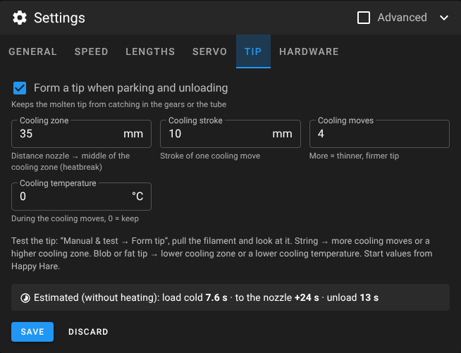

# Voron0-AutoLoader

> [!NOTE]
> **This repository was written by Claude Opus 5.5**, Anthropic's AI model – Klipper macros, installer, web UI and
> documentation – together with Dennis ([Screase3D](https://github.com/Screase3D)), who designed and built the
> hardware and tested it on his printer. Review the macros before using them on your printer and watch the first
> runs with a hand on the emergency stop.

**Automatic filament loader for the Voron V0.2** – Klipper macros, a one-command installer and a Mainsail page
that shows where the filament is.

[](LICENSE)


A small loader with BMG gears and a NEMA17 sits next to the printer and pushes the filament through a PTFE tube
into the toolhead. An MG90S servo presses the idler gear onto the filament while the loader is feeding and lets go
afterwards, so the loader never fights the extruder. Two normally closed micro switches tell Klipper where the
filament is: one at the loader entrance, one directly in front of the extruder gears in the toolhead.


## Contents

- [Features](#features)
- [Screenshots](#screenshots)
- [Hardware](#hardware)
- [Installation](#installation)
- [First setup](#first-setup)
- [Using the page](#using-the-page)
- [How it works](#how-it-works)
- [Macros](#macros)
- [Settings](#settings)
- [Files](#files)
- [Troubleshooting](#troubleshooting)
- [Safety](#safety)
- [Credits](#credits)
- [License](#license)

## Features

- **Load cold** – feeds the filament from the loader through the tube into the extruder gears. The hotend can stay cold.
- **Load hot** – heats the hotend, loads (if needed), extrudes to the nozzle and purges.
- **Park** – forms a clean tip and pulls the filament back just behind the toolhead sensor. It stays in the PTFE
  tube, so the next load takes only a few seconds.
- **Unload with tip forming** – heats, shapes a clean filament tip (ramming, break-off, cooling moves – the approach
  known from ERCF / Happy Hare), then pulls the filament all the way back into the loader.
- **Remembers where the filament is** – the position is stored with Klipper's `[save_variables]` and survives
  restarts and power-off. At start-up it is checked against the sensors; if filament was removed or inserted
  while the printer was off, the position is corrected and you get a notice.
- **Fast** – full speed (150 mm/s by default, presets up to 250 mm/s) through the tube; the sensor is only searched
  on the last few centimetres. The loader knows how far the filament already is (e.g. parked) and only feeds the rest.
- **Auto load** – push filament into the loader entrance and it is loaded on its own, into the extruder gears
  (cold) or all the way to the nozzle (hot).
- **Print hooks** – `PRINT_START` loads automatically if the toolhead is empty; after the print the filament can
  stay, be parked in the tube or be unloaded completely.
- **Mainsail / KlipperScreen buttons** – `LOAD_FILAMENT` and `UNLOAD_FILAMENT` use the loader, also for filament
  changes during a pause.
- **Nozzle off afterwards** – after loading/unloading the nozzle is switched off (not during a print or pause).
- **Mainsail page** with two modes – *Operate* for everyday use and *Setup & calibration* for everything that can
  move the loader in unusual ways – a live drawing of the filament path, material temperature presets, history,
  calibration helpers and a settings editor with plain-language fields.
- **Bench mode** – the auto trigger only clamps, runs a test distance and releases. Safe for testing the loader on
  the table before it is mounted.
- **KlipperScreen menu** (More → AutoLoader), **English and German**, **updates** through Moonraker's update manager.

## Screenshots

| Control | Filament path while loading |
|---|---|
|  |  |

| Setup & calibration |
|---|
|  |

| Manual & test | Measuring the lengths | Stepper calibration |
|---|---|---|
|  |  |  |

| Settings | Speed presets | Lengths sketch |
|---|---|---|
|  |  |  |

## Hardware

The loader hardware is inspired by **[fila_feeder](https://github.com/DarkK9Design/fila_feeder)** by
DarkK9Design – an automatic filament feeder with a NEMA17, BMG gears, an MG90S servo and a micro switch.

> [!NOTE]
> **The STEP/STL files and a build guide for this loader will be added to this repository later.**

| Part | Notes |
|---|---|
| Printer | Voron V0.2 with BTT SKR Pico V1.0, Nitehawk-SB toolhead board, BTT Pi / CB1 |
| Toolhead | e.g. Dragon Burner V0 with FYSETC CNC Sherpa Mini and Phaetus Dragon HF (the tip-forming defaults start here) |
| Loader | BMG-style dual gear drive (drive gear on the stepper, idler gear on a swing arm) |
| Stepper | NEMA17 on the free **E0** driver of the SKR Pico (TMC2209, UART) |
| Servo | MG90S, presses the idler arm |
| Sensor 1 | micro switch at the loader entrance, normally closed (NC) |
| Sensor 2 | micro switch at the toolhead entrance, a few mm above the extruder gears, NC |
| PTFE tube | loader → toolhead (measured on the page; about 600 mm on the prototype) |

### Default wiring

| Function | Board | Header | Pin |
|---|---|---|---|
| Stepper step / dir / enable | SKR Pico | E0 driver | `gpio14` / `!gpio13` / `!gpio15` |
| TMC2209 UART | SKR Pico | shared UART | `gpio9` / `gpio8`, address 3 |
| Servo signal | SKR Pico | SERVOS | `gpio29` (not `gpio21` – that is the bed heater) |
| Sensor 1 | SKR Pico | E0-STOP | `^gpio16` |
| Sensor 2 | Nitehawk-SB | IO | `^nhk:gpio12` – the MCU name must match `[mcu …]` in your `nitehawk-sb.cfg` |

Both switches are **normally closed**: no filament = contact closed = pin low. They use the pull-up (`^`) and are
**not** inverted. A broken wire therefore reads as "filament present". All pins can be changed in the installer or
later on the page.

## Installation

Requirements: Klipper, Moonraker, Mainsail (nginx), Python 3, and `[respond]` / `[pause_resume]` (both come with
`mainsail.cfg`).

```bash
cd ~
git clone https://github.com/Screase3D/Voron0-AutoLoader.git
cd Voron0-AutoLoader
./install.sh --analyze     # look only, changes nothing
./install.sh --dry-run     # show what would happen
./install.sh               # install
```

Do not run it with `sudo` – it asks for sudo itself where needed (nginx).

The installer

1. backs up your config folder to `~/autoloader-backups/`,
2. links `filament_loader.cfg` (the macros) into your config folder as a symlink to the repo,
3. creates `filament_loader_settings.cfg` with your pins and parameters, and `[save_variables]` for the stored
   filament position if your config does not have one yet,
4. takes over the calibrated values of an existing single-file `filament_loader.cfg` (renamed to `.old`),
5. comments out clashing sections, e.g. an old filament sensor on the same pin or your own `LOAD_FILAMENT` /
   `UNLOAD_FILAMENT` macros (marked with `#loader# `, restored on uninstall),
6. adds both includes to `printer.cfg`,
7. on request inserts `LOADER_PRINT_START` after the nozzle heat-up (`M109`) in `PRINT_START` and
   `LOADER_PRINT_END` before `TURN_OFF_HEATERS` in `PRINT_END` (marked `# autoloader`),
8. adds the web UI to nginx and a menu entry **AutoLoader** to Mainsail,
9. registers the update manager in `moonraker.conf`,
10. optionally adds the KlipperScreen menu,
11. restarts Klipper.

`filament_loader_settings.cfg` belongs to you. Updates never touch it; the installer only regenerates it when you
confirm (or with `--reconfigure`). Settings added by newer versions are appended with their defaults when you run
`./install.sh` again (your values stay), or by saving once on the page.

| Option | Effect |
|---|---|
| `--analyze` | analyse only |
| `--dry-run` | show all changes without writing anything |
| `--reconfigure` | ask for the settings again and regenerate the settings file |
| `--yes` | accept all suggestions (non-interactive) |
| `--lang de\|en` | language of the installer and of the Klipper messages |
| `--no-web` | skip nginx and the Mainsail menu entry |
| `--no-hooks` | do not touch `PRINT_START` / `PRINT_END` |
| `--no-restart` | do not restart Klipper |
| `--klipperscreen` / `--no-klipperscreen` | add / skip the KlipperScreen menu |
| `--config-dir`, `--nginx-site` | non-standard paths |

**Update:** Mainsail → *Machine → Update Manager* → `voron0-autoloader`, or a notice on the AutoLoader page.
After an update run `./install.sh` once if the page says that new settings are available.

**Uninstall:** `cd ~/Voron0-AutoLoader && ./uninstall.sh` – removes includes, symlink, nginx entry, menu entries,
print hooks and update manager entry, restores the sections the installer commented out and puts back your previous
single-file `filament_loader.cfg` if the installer had taken it over. The settings file is kept unless you choose to
delete it.

## First setup

Switch the page to **Setup & calibration**. The checklist there ticks itself off where it can:

1. **Sensor 1** – insert and remove filament, the status changes.
2. **Servo angles** – *Manual & test → Servo*: move to an angle until the idler arm presses the filament, then
   *Use as clamp angle*. Same for the release angle. Save in the settings.
3. **Stepper** – *Calibrate stepper*: mark the filament, run 100 mm, measure, enter the measured length,
   *Apply to settings*, save. If it runs backwards, invert `dir_pin` (`!`).
4. **Bench test** – with bench mode on (default), inserting filament clamps, feeds `bench_dist` and releases.
5. **Mount on the printer**, wire sensor 2 and enable it under *Settings → Hardware*.
6. **Measure the lengths** (*Measure lengths*):
   - `tube_len`: put the tip flush with the loader gears, press *To sensor 2* – the loader runs fast up to
     *Fast up to* (must be safely shorter than the real distance), searches the sensor up to *Max.* and shows the
     distance. For a long tube raise *Max.* (e.g. 800 mm).
   - `gear_offset`: the servo stays clamped after *To sensor 2*; push on in 1 / 0.5 mm steps until the tip touches
     the extruder gears, then apply – that releases the servo.
   - `ext_to_nozzle`: after a cold load, extrude in 5 / 1 mm steps (hot) until filament comes out of the nozzle.
7. **Tip forming** – *Manual & test → Form tip*, then pull the filament and look at the tip (see below).
8. **Turn bench mode off** – the auto trigger now loads for real.
9. **Cold load → hot load → park → load again → unload** – watch the first runs.
10. **Print hooks** – start a print with an empty toolhead and filament at the loader entrance.

## Using the page

Mainsail → **AutoLoader** (`/server/autoloader/`). The page uses Mainsail's own stylesheets and your theme.

- **Operate** – filament path, *Control* and history. *Control* shows where the filament is (stored position),
  both sensors and the hotend, has the temperature with material presets (PLA, PETG, ABS, ASA, TPU, PA), the purge
  length and the buttons *Load cold*, *Load hot*, *Park* and *Unload*. Below are the everyday switches – *Auto load*,
  *Load to* (extruder / nozzle), *Nozzle off afterwards* and *After the print* (nothing / park / unload). They are
  written to the settings file right away, without a restart.
- **Setup & calibration** – checklist with the state of the print hooks and of the position storage, *Manual &
  test* (clamp, release, stop, stepper moves, servo angles, bench mode, tip test, **correct the position**),
  *Measure lengths*, *Calibrate stepper* and the **settings editor**.

The chosen mode is remembered per browser. The console at the bottom is always there.

## How it works

### Where is the filament?

Klipper tracks the position of the filament tip (`pos` and `tip`, mm from the loader gears): every loader move with
the servo clamped is added up, and sensor 2 resets it to the exact value. After every operation the position is
stored with `SAVE_VARIABLE` (`autoloader_pos`, `autoloader_tip`, `autoloader_tip_known`).

| Position | Meaning |
|---|---|
| `none` | no filament in the loader |
| `loader` | tip in the loader (after unloading: `unload_hold` mm past the loader gears) |
| `tube` | tip in the PTFE tube, e.g. parked `park_dist` mm behind sensor 2 |
| `sensor2` | tip at sensor 2 – whether the extruder grips it is unknown |
| `gears` | tip in the extruder gears (after *Load cold*) |
| `nozzle` | loaded to the nozzle (after *Load hot*) |

**At start-up** `_LOADER_SYNC` compares the stored position with the sensors:

| Stored | Sensors now | Result |
|---|---|---|
| loaded (`gears`/`nozzle`) | sensor 2 has filament | unchanged |
| loaded | only sensor 1 | filament was pulled back – `tube`, exact place unknown, notice |
| loaded | no filament | filament was removed – `none`, notice |
| anything else | sensor 2 has filament | `sensor2` (inserted by hand), notice |
| `loader` / `tube` | no filament | `none` |

If the exact place in the tube is unknown, the next load does not trust it: it searches sensor 2 carefully in
5 mm steps instead of the full-speed move. If the stored position is wrong because the filament was moved by hand
while the printer was on, the page notices the mismatch and runs the check by itself; *Setup → Manual & test →
Correct the position* sets it by hand.

### Load cold – `FILAMENT_LOAD_COLD`

1. Servo clamps.
2. The loader feeds at full `speed` up to `approach` mm before sensor 2 – from wherever the tip is (`tube_len −
   approach − tip`).
3. It continues in steps of `step_mm` at `slow_speed` until sensor 2 triggers (timeout after another `approach +
   overrun`). If sensor 2 already triggers during the full-speed move, the load stops with an error instead of
   ramming the filament into the extruder.
4. It pushes `gear_offset + gear_push` further, so the tip ends up between the extruder gears.
5. Servo releases, the stepper is switched off. Position: `gears`.

### Load hot – `FILAMENT_LOAD TEMP=… PURGE=…`

Starts heating first, loads cold if needed (or only pushes into the gears if the tip is at sensor 2), waits for the
temperature, then the extruder pushes `ext_to_nozzle` and purges `purge_len`. Position: `nozzle`.

### Unload – `FILAMENT_UNLOAD TEMP=…` and park – `FILAMENT_PARK TEMP=…`

1. Servo releases, the hotend heats up.
2. **Tip forming** (`tip_enable`):
   - optional ramming (`tip_ram_len`),
   - 15 mm fast break-off (`tip_speed_start`), then slower into the cooling zone (`tip_cool_pos` mm above the
     nozzle, `tip_speed`),
   - optional temperature drop (`tip_temp`),
   - `tip_cool_moves` cooling moves of `tip_cool_len` mm with the speed rising from `tip_cool_start` to
     `tip_cool_end`.
3. The extruder retracts the rest up to `unload_ext_len` (counted from the nozzle, including the tip forming).
4. The loader clamps, the extruder motor is switched off, the loader pulls until sensor 2 is free.
5. **Unload:** on to `unload_hold` mm inside the loader (position `loader`).
   **Park:** only `park_dist` mm behind sensor 2 (position `tube`) – the next load starts right there.

If the filament is parked, *Unload* pulls it back into the loader without heating.

Tuning the tip: run *Form tip* (`LOADER_FORM_TIP`), pull the filament and look at it. A thin string → more cooling
moves or a higher `tip_cool_pos`. A blob or a fat tip → lower `tip_cool_pos` or set a lower `tip_temp`. The
defaults are the Happy Hare starting values – a starting point for the Dragon HF, not a measured profile.



Long extruder moves are split into pieces below Klipper's `max_extrude_only_distance` (default 50 mm).

### Print hooks

`LOADER_PRINT_START` runs right after the nozzle has reached its temperature:

| `print_start_mode` | Sensor 2 empty, filament at sensor 1 | Sensor 2 empty, nothing at sensor 1 |
|---|---|---|
| `2` (default) | loads to the nozzle without purge – your purge line follows | print aborts |
| `1` | print aborts | print aborts |
| `0` | nothing | nothing |

`LOADER_PRINT_END` (before the heaters are switched off): `print_end_action` `0` nothing, `1` park in the tube,
`2` unload completely.

### Auto trigger

`[filament_switch_sensor loader_in]` calls `FILAMENT_LOADER_AUTO` when filament is inserted. If `auto_enable` is on,
after `auto_delay` it runs the bench test (bench mode), a cold load (`auto_target = "cold"`) or a hot load to the
nozzle (`auto_target = "hot"`, current target temperature or `default_temp`). Klipper only fires `insert_gcode`
when no print is running. During a print, sensor 1 acts as runout sensor and pauses the print.

### Mainsail / KlipperScreen buttons

`LOAD_FILAMENT` and `UNLOAD_FILAMENT` call `FILAMENT_LOAD` / `FILAMENT_UNLOAD`. Temperature: `TEMP=`, otherwise the
current extruder target, otherwise `default_temp`. They also work while a print is paused (filament change).

## Macros

| Macro | Purpose |
|---|---|
| `FILAMENT_LOAD_COLD` | load into the extruder gears |
| `FILAMENT_LOAD TEMP= PURGE=` | load to the nozzle |
| `FILAMENT_PARK TEMP=` | form the tip, park `park_dist` mm behind sensor 2 |
| `FILAMENT_UNLOAD TEMP=` | form the tip, unload into the loader |
| `LOAD_FILAMENT` / `UNLOAD_FILAMENT` | Mainsail / KlipperScreen buttons → loader |
| `LOADER_PRINT_START` / `LOADER_PRINT_END` | print hooks |
| `LOADER_STATUS` | sensors, stored position, bench mode |
| `LOADER_SYNC` | check the stored position against the sensors |
| `LOADER_SET_POS POS= [TIP=]` | set the stored position by hand (`none`, `loader`, `tube`, `sensor2`, `gears`, `nozzle`) |
| `LOADER_CLAMP ANGLE=` / `LOADER_RELEASE ANGLE=` | servo, optional angle for testing |
| `LOADER_MOVE DIST= SPEED= CLAMP=1/0` | move the loader (negative = back) |
| `LOADER_BENCHTEST DIST=` | clamp, move, release |
| `LOADER_STOP` | release and switch the stepper off |
| `LOADER_FORM_TIP TEMP=` | only form the tip (filament stays in the extruder) |
| `LOADER_TO_SENSOR COARSE= MAX= HOLD=1` | measuring: feed fast to `COARSE`, search sensor 2 up to `MAX`, report the distance |
| `LOADER_NUDGE DIST=` | measuring: push DIST mm, servo stays clamped (finish with `LOADER_STOP`) |
| `LOADER_EXTRUDE DIST= TEMP=` | measuring: extrude with the extruder (releases the loader first) |
| `LOADER_AUTO ENABLE=1/0` / `LOADER_BENCH VALUE=1/0` | auto load / bench mode until restart |

The macros refuse to run while printing, except when called by the print hooks.

## Settings

All values live in `filament_loader_settings.cfg` and are edited on the page under **Setup → Settings**:
grouped by task (*General, Speed, Lengths, Servo, Tip, Hardware*), every field with unit and a one-line
explanation, fine-tuning and pins behind **Advanced**, **↺** to reset a field to its default, inline errors, speed
presets *Quiet / Normal / Fast*, a sketch of all lengths (click a dimension to jump to its field) and a time
estimate. Saving shows a diff, keeps the previous version as `.bak` and restarts Klipper.

| Variable | Default | Meaning |
|---|---|---|
| `speed` | 150 | mm/s full speed through the tube |
| `slow_speed` | 30 | mm/s sensor search and hand-over to the extruder |
| `accel` (`[manual_stepper loader]`) | 1500 | mm/s² acceleration of the loader |
| `run_current` (`[tmc2209 …]`) | 0.6 | A motor current – more for high speeds |
| `stealthchop_threshold` (`[tmc2209 …]`) | 60 | mm/s: below quiet StealthChop, above strong SpreadCycle (0 = always SpreadCycle) |
| `step_mm` | 2 | mm per sensor check |
| `approach` | 30 | mm before sensor 2 where the full-speed move ends and the sensor search starts |
| `tube_len` | 300 | mm from the loader gears to sensor 2 |
| `overrun` | 40 | mm beyond the expected sensor point before the timeout |
| `gear_offset` | 8 | mm from sensor 2 to the extruder gears |
| `gear_push` | 3 | mm the loader pushes beyond the gears |
| `ext_to_nozzle` | 70 | mm from the extruder gears to the nozzle |
| `ext_speed` | 5 | mm/s extruder speed while loading |
| `purge_len` / `purge_speed` | 30 / 3 | purge after loading |
| `default_temp` | 220 | °C when no `TEMP=` is given |
| `unload_ext_len` | 65 | mm the extruder retracts in total when unloading (from the nozzle, incl. tip forming) |
| `unload_hold` | 15 | mm of filament left in the loader after unloading |
| `park_dist` | 20 | mm behind sensor 2 when parking |
| `servo_clamp` / `servo_release` | 45 / 170 | servo angles in degrees |
| `servo_settle` | 0.5 | s to wait after a servo move |
| `servo_off_released` | 1 | switch the servo signal off after releasing |
| `auto_enable` | 1 | load automatically when filament is inserted |
| `auto_target` | "cold" | auto load into the extruder (`cold`) or to the nozzle (`hot`) |
| `auto_delay` | 2.0 | s before the auto trigger clamps |
| `heater_off` | 1 | switch the nozzle off after loading/unloading (not during a print or pause) |
| `bench_mode` / `bench_dist` | 1 / 50 | bench mode and its test distance |
| `print_start_mode` | 2 | 0 off, 1 check only, 2 load automatically |
| `print_end_action` | 0 | 0 nothing, 1 park, 2 unload |
| `tip_enable` | 1 | form a tip before parking/unloading |
| `tip_ram_len` | 0 | mm ramming before the break-off |
| `tip_temp` | 0 | °C for the cooling moves (0 = keep) |
| `tip_speed_start` / `tip_speed` | 80 / 18 | mm/s break-off / retract into the cooling zone |
| `tip_cool_pos` / `tip_cool_len` | 35 / 10 | mm nozzle → middle of the cooling zone / stroke of a cooling move |
| `tip_cool_moves` | 4 | number of cooling moves |
| `tip_cool_start` / `tip_cool_end` | 10 / 50 | mm/s first / last cooling move |
| `tip_eject_speed` | 25 | mm/s remaining retraction |
| `lang` | de | language of the Klipper messages (`de` / `en`) |

The sensor search runs in steps of `step_mm`. Each step is a separate macro call that reads the sensor fresh,
because Klipper does not allow a macro to call itself.

**Speed:** with BMG gears (`rotation_distance` ≈ 23 mm) 150 mm/s are about 6.5 motor revolutions per second,
250 mm/s about 11. That needs SpreadCycle (`stealthchop_threshold` below the feed speed), enough acceleration and
usually 0.6–0.8 A. If the loader skips steps or stalls: lower the speed or the acceleration first, then raise the
current a little.

## Files

```
klipper/filament_loader.cfg               macros (symlinked, updated by the update manager)
klipper/filament_loader_settings.cfg.tpl  template for your settings file
klipperscreen/autoloader_{de,en}.conf     KlipperScreen menu
scripts/installer.py, scripts/i18n.py     installer (Python standard library only)
web/index.html                            the Mainsail page (single file)
docs/images/                              screenshots
```

In your config folder: `filament_loader.cfg` (symlink), `filament_loader_settings.cfg` (yours) and
`autoloader_variables.cfg` (stored position, written by Klipper – only if you had no `[save_variables]` before).

## Troubleshooting

- **"macros not found"** on the page – run `./install.sh --analyze` and check the includes in `printer.cfg`.
- **Sensor shows filament with nothing inserted** – check the wiring; with NC switches a broken wire reads as
  "filament present". The pin must be `^pin` without `!`.
- **Unknown pin / MCU** for sensor 2 – the prefix (`nhk:`) must match the MCU name of the toolhead board.
- **Loader runs backwards** – invert `dir_pin` in the settings.
- **Timeout before sensor 2** – increase `tube_len` / `overrun`, check for friction in the tube.
- **"Sensor 2 was already reached during the full-speed move"** – `tube_len` is too large or the stored position
  is wrong. Measure `tube_len` with *To sensor 2* or correct the position.
- **Position notice after switching on** – the filament was moved while the printer was off. Check it and confirm;
  if needed set the position under *Setup → Manual & test*.
- **"Position storage missing"** in the checklist – run `./install.sh` once, it adds `[save_variables]`.
- **Page stays grey / buttons locked after an error** – the page detects an aborted operation and shows it as
  *aborted* with a *Release* button.
- **Loader stalls or skips at high speed** – lower `speed` / `accel`, set `stealthchop_threshold` below the speed,
  raise `run_current` slightly.
- **Filament stays in front of the extruder gears** – increase `gear_push` a little, check `gear_offset`.
- **Filament jams in the tube or the loader after unloading** – the tip is too fat or stringy; tune the tip forming.
- **"Extrude below minimum temp"** – extruder moves need a hot nozzle (`min_extrude_temp`).
- **Page not reachable** – `sudo nginx -t`. The home directory must be accessible to nginx (`chmod o+x ~`).

## Safety

Loading, parking and unloading move the extruder and heat the hotend. Watch the first runs and keep the emergency
stop at hand. During a print all loader operations and the settings editor are locked. Everything that can move the
loader in unusual ways is on the *Setup & calibration* side of the page.

## Credits

| Project | Author | Relation |
|---|---|---|
| [Claude](https://www.anthropic.com/claude) (Opus 5.5) | Anthropic | wrote the code and documentation of this repository |
| [fila_feeder](https://github.com/DarkK9Design/fila_feeder) | DarkK9Design | inspiration for the loader hardware (NEMA17, BMG gears, MG90S servo, micro switch) |
| [VoronV0-Zeroclick-Mainsail-UI](https://github.com/Screase3D/voronv0-zeroclick-mainsail-ui) | Screase3D | installer, page shell and theme handling are based on it |
| [Happy Hare](https://github.com/moggieuk/Happy-Hare) | moggieuk | tip-forming sequence and its default values |
| [ERCF](https://github.com/Enraged-Rabbit-Community/ERCF_v2) | Enraged Rabbit Community | the filament-changer world where tip forming for Klipper comes from |
| [Voron V0](https://github.com/VoronDesign/Voron-0) | Voron Design | the printer |
| [Klipper](https://github.com/Klipper3d/klipper) | Kevin O'Connor and contributors | firmware |
| [Moonraker](https://github.com/Arksine/moonraker) | Eric Callahan (Arksine) | API and update manager |
| [Mainsail](https://github.com/mainsail-crew/mainsail) | mainsail-crew | web interface whose look this page adopts |
| [Vuetify](https://github.com/vuetifyjs/vuetify) | Vuetify team | component framework behind Mainsail's styles |
| [Material Design Icons](https://pictogrammers.com/library/mdi/) | Pictogrammers | icons |

This project is not affiliated with or endorsed by any of the projects above.

## License

GPL-3.0-or-later – see [LICENSE](LICENSE). Icons: Material Design Icons (Apache-2.0). Details in
[THIRD_PARTY_NOTICES.md](THIRD_PARTY_NOTICES.md).
