# Assembly guide

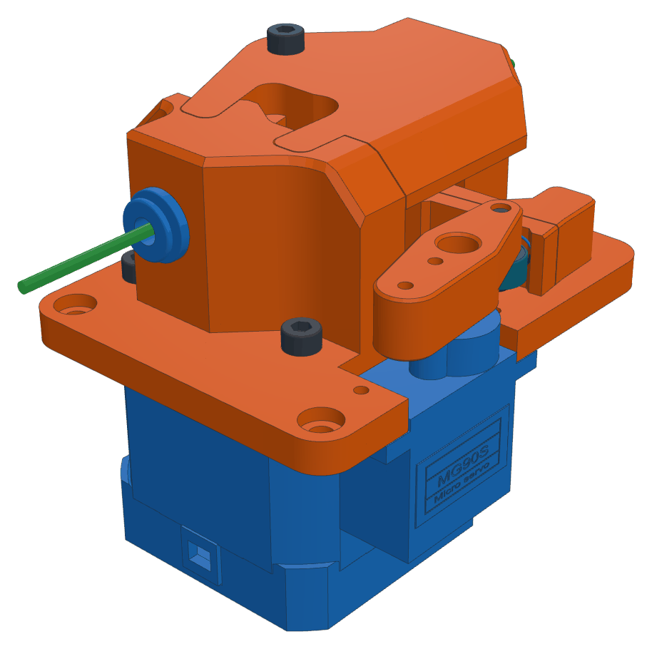 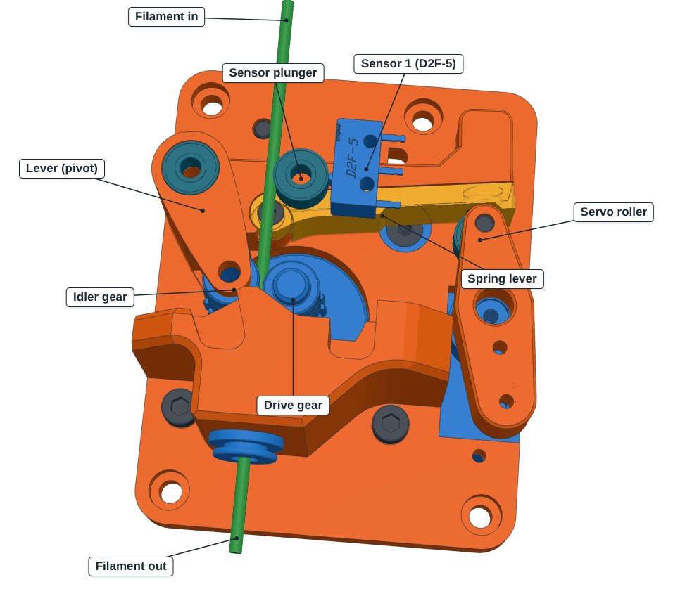

Orange = printed, blue = hardware, dark = screw, teal = bearing, grey = already mounted.

## Parts

**Printed:** Main Plate, Bowden In Bearing (housing), Lever Spring V3 (lever), Lever Spring Lever V3 (spring lever),
Bearing Horn Adapter

| Qty | Hardware | Qty | Screws |
|---|---|---|---|
| 1 | NEMA17 stepper | 1 | M3×35 SHCS |
| 1 | MG90S servo | 2 | M3×8 SHCS |
| 1 | BMG gear set + Ø3×20 shaft | 1 | M3×8 countersunk |
| 4 | 693ZZ bearing | 2 | M3×10 SHCS |
| 1 | Omron D2F-5 | 1 | M3×10 button head |
| 2 | ECAS04 | 1 | M2×6 SHCS |
| 1 | spring 0.4×5×15 | 2 | M2×10 selfcutting |
| 2 | Neodym magnet 6x3mm | 2 | / |

## Steps

**1.** ECAS04 into the main plate.

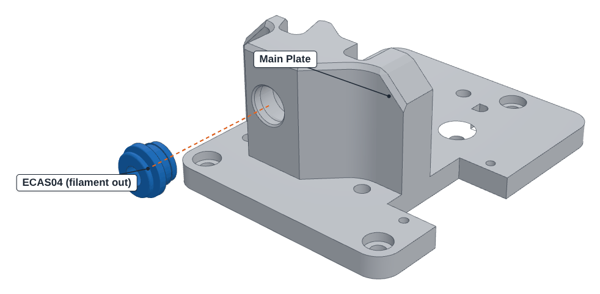

**2.** Motor: 2× M3×8, 1× M3×8 countersunk. Leave the fourth hole free (pivot).

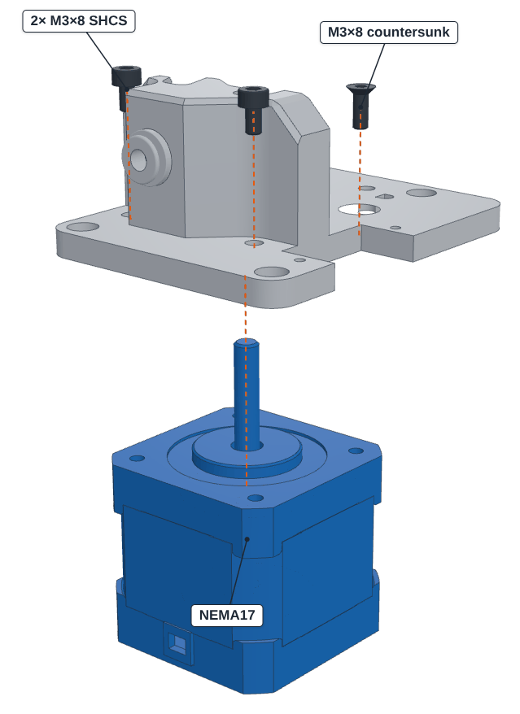

**3.** Drive gear: groove at filament height, grub screw with threadlocker.

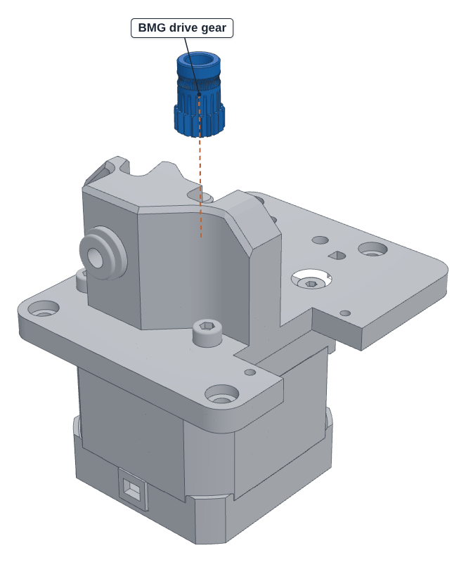

**4.** Servo from below, with its two screws.

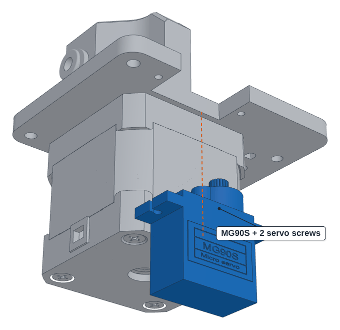

**5.** Lever: 2× 693ZZ, idler gear + shaft, spring, spring lever with M2×6 (must swing freely).

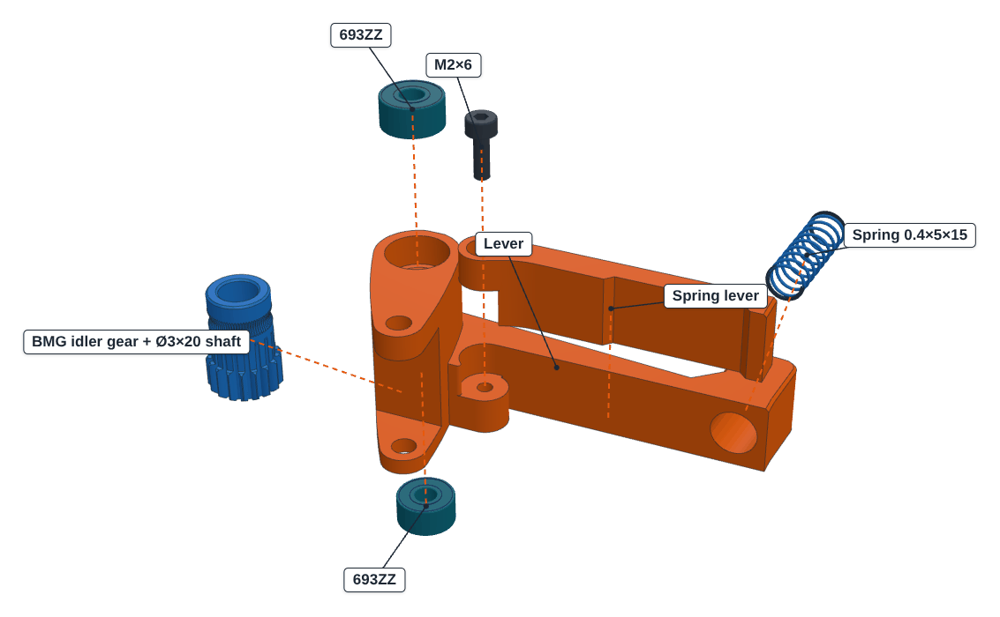

**6.** Lever onto the plate.

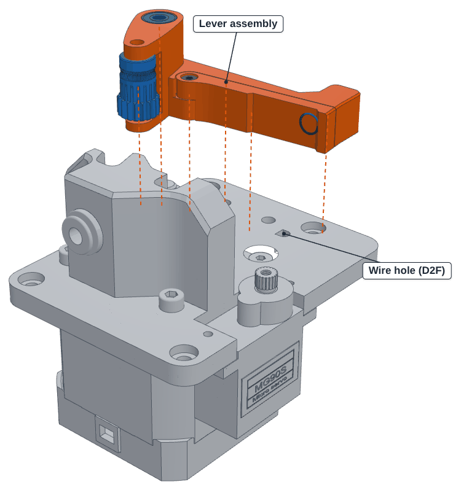

**7.** Housing: 693ZZ into the slot, D2F-5 (wired COM + NC) with 2× M2×10, ECAS04.

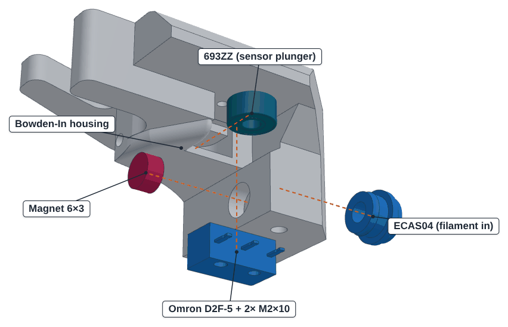

**8.** Housing on top: M3×35 through everything into the motor, 2× M3×10 from below.

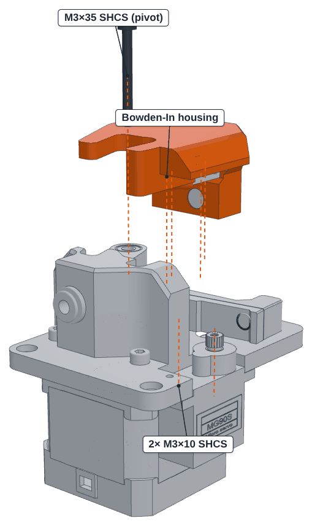

**9.** 693ZZ with M3×10 button head under the horn adapter, adapter onto the horn.

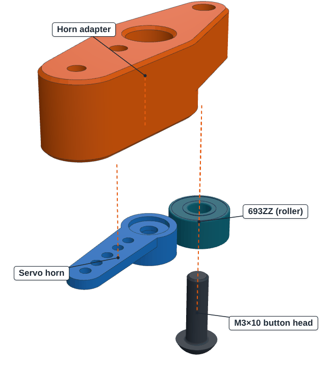

**10.** `LOADER_RELEASE`, then put the horn on with the roller just clear. Angles: *Setup & calibration → Servo angles*.

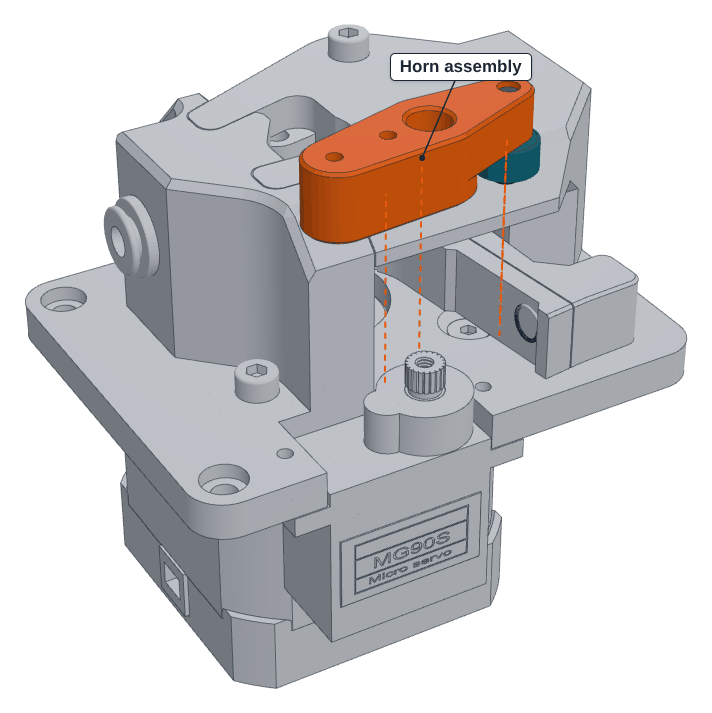

**11.** Mount (4× M3), PTFE in, wiring: [pins](../README.md#hardware), then [first setup](../README.md#first-setup).
