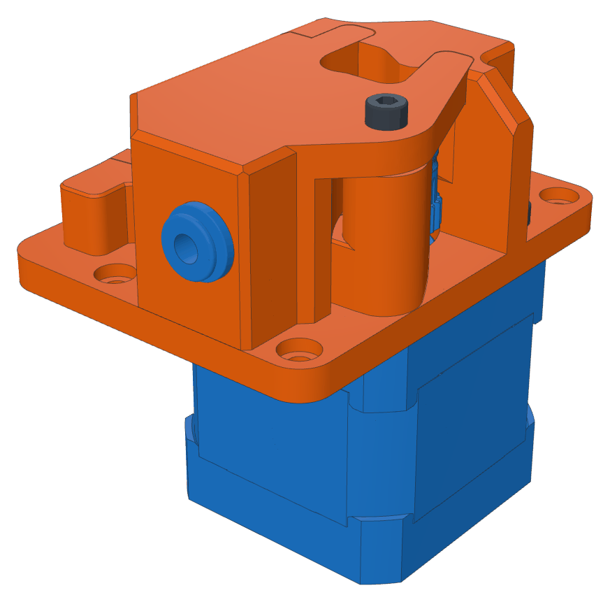
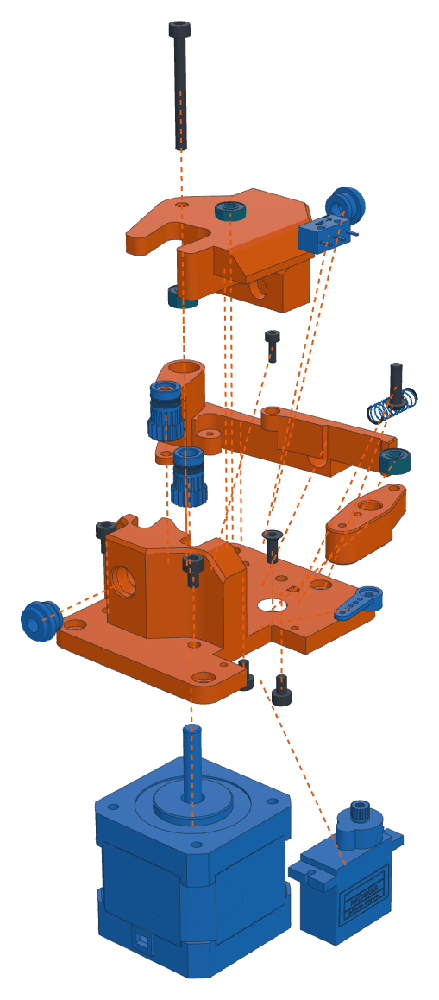

# Assembly guide

How to build the filament loader (CAD model *Filament Feeder v21*). All pictures are rendered from the STEP
assembly: **orange** = printed part, **blue** = purchased part, **dark** = screw, **teal** = bearing, **grey** =
already mounted. Dashed lines show where a part goes. STEP/STL files will be added to the repo later.

 

## How it works

The filament comes in through the coupling at the back, runs past the **sensor plunger** – a 693ZZ that the
filament pushes against the **D2F-5 switch** (sensor 1) – then between the **drive gear** on the motor and the
**idler gear** on the lever, and leaves through the front coupling towards the toolhead.

To clamp, the servo turns its horn: the **roller** on the horn presses the **spring lever**, which pushes the
**lever** through a spring. The lever pivots on two bearings and presses the idler gear against the drive gear –
always with spring force, so small differences in the clamp angle don't matter much. To release, the servo turns back and the idler
gear lifts off.

 

## Parts

**Printed** – suggested: Voron standard settings (ABS/ASA, 0.2 mm layers, 4 walls, 40 % infill).

| Part (name in the STEP) | Qty | Used in |
|---|---|---|
| Main Plate | 1 | base, motor and servo mount, output coupling |
| Bowden In Bearing (housing) | 1 | input coupling, sensor, top of the lever pivot |
| Lever Spring V3 (lever) | 1 | holds the idler gear |
| Lever Spring Lever V3 (spring lever) | 1 | the servo presses it, it presses the lever through the spring |
| Bearing Horn Adapter | 1 | carries the roller on the servo horn |

**Hardware**

| Part | Qty | Note |
|---|---|---|
| NEMA17 stepper, 5 mm shaft | 1 | 40 mm body in the model |
| MG90S micro servo | 1 | with its single-arm horn and screws |
| BMG gear set: drive gear, idler gear, Ø3×20 mm idler shaft | 1 | the shaft is not in the model |
| 693ZZ bearing (3×8×4 mm) | 4 | 2× lever pivot, sensor plunger, servo roller |
| Omron D2F-5 micro switch | 1 | sensor 1 |
| ECAS04 push-fit coupling (4 mm PTFE) | 2 | in / out |
| Compression spring 0.4×5×15 mm (wire × OD × length) | 1 | between lever and spring lever |

**Screws**

| Screw | Qty | Where | Note |
|---|---|---|---|
| M3×35 SHCS | 1 | lever pivot, through housing, lever and plate into the motor | model shows M3×30, which ends 0.4 mm above the motor thread |
| M3×8 SHCS | 2 | motor | model shows M3×5, which does not reach through the 5 mm plate |
| M3×8 countersunk (ISO 10642) | 1 | motor, under the switch | |
| M3×10 SHCS | 2 | housing, from below | model shows M3×5; the housing has Ø2.8 holes, 6 mm deep |
| M3×10 button head (ISO 7380) | 1 | roller on the horn adapter | |
| M2×6 SHCS | 1 | spring lever | |
| M2×10 | 2 | switch, from below | not in the model; Ø1.8 holes, 6 mm deep |
| servo screws | 2 + 1 | servo mount + horn | come with the servo |
| M3 for mounting | 4 | counterbored corner holes | length depends on your mount |

Tools: hex keys 1.5 / 2 / 2.5 mm, small Phillips screwdriver, soldering iron, blue threadlocker.

## Assembly

### 1. Output coupling

Press the ECAS04 into the block of the main plate. This is where the filament leaves towards the toolhead.

### 2. Motor

Hold the motor under the plate and screw it on from the top: 2× M3×8 SHCS (one goes down through the bore in the
block – long hex key) and the M3×8 countersunk screw. **Leave the fourth hole empty** – the pivot screw goes there in step 8.

### 3. Drive gear

Slide the drive gear onto the motor shaft. Its groove has to be at filament height, about 13.7 mm above the top of
the plate – easiest with a piece of filament pushed through the output coupling. Tighten the grub screw on the
flat of the shaft, with a drop of threadlocker.

### 4. Servo

Push the servo up through the cut-out from below and fix it with the two screws from the servo bag through its
mounting ears into the Ø2 mm holes.

### 5. Lever

1. Press one 693ZZ into the pivot bore from the top and one from the bottom.
2. Put the idler gear between the two lugs and push the Ø3×20 mm shaft through.
3. Put the spring into its pocket between lever and spring lever.
4. Fix the spring lever with the M2×6 – only snug, it has to swing freely.

### 6. Lever onto the plate

Set the lever onto the plate: the bearings over the empty motor hole, the idler gear next to the drive gear. Check
that it swings freely.

### 7. Sensor and input coupling

1. Solder two wires to **COM** and **NC** of the D2F-5 (normally closed: no filament = closed).
2. Slide the 693ZZ sensor plunger into its slot in the housing, from the switch side.
3. Put the switch into its pocket from below, plunger towards the bearing, and fix it with 2× M2×10.
4. Press the second ECAS04 into the housing (filament in).

Test: a piece of filament pushed through the input coupling must click the switch.

### 8. Housing

Put the housing over the lever. Screw the M3×35 from the top through the housing, the upper bearing, the lever,
the lower bearing and the plate into the motor – snug, the lever has to keep swinging freely (if the screw bottoms
out in the motor thread, add a washer under the head). Then 2× M3×10 from below through the plate into the
housing. Route the switch wires down through the small hole next to the switch.

### 9. Roller on the servo horn

Screw the 693ZZ roller to the underside of the horn adapter with the M3×10 button head. Put the adapter over the
servo horn.

### 10. Horn onto the servo

Connect the servo and run `LOADER_RELEASE` – the servo goes to its release angle. Put the horn on the servo
shaft so that the roller is just clear of the spring lever, and fix it with the horn screw. Check with
`LOADER_CLAMP` that the idler gear clamps, then fine-tune both angles on the page under *Setup & calibration →
Servo angles*.

### 11. Mount and connect

- Mount the loader with four M3 screws in the counterbored corner holes.
- PTFE (4 mm OD) from the spool into the input coupling, from the output coupling to the toolhead.
- Stepper to the E0 driver, servo to the SERVOS header, switch to the sensor 1 input – default pins are in the
  [README](../README.md#hardware).
- Continue with [First setup](../README.md#first-setup).
