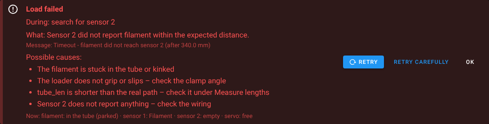

# How it works

Details behind the [README](../README.md): how the loader moves, all macros and all settings.

**Wiring.** Both switches are NC, use the pull-up and are not inverted (no filament = closed = low).

**Installer.** Backs up your config, links the macros, links the Klipper module `autoloader_sync.py` into
`~/klipper/klippy/extras/` (hidden from git, so Moonraker doesn't flag Klipper), creates `filament_loader_settings.cfg`
(yours – updates never overwrite it) with `[save_variables]` and `[autoloader_sync]`, comments out clashing sections,
adds the includes and – on request – the print hooks, the Mainsail page, the update manager entry and the
KlipperScreen menu. Options: `--analyze`, `--reconfigure`, `--yes`, `--lang de|en`, `--klipper-dir`, `--no-web`,
`--no-hooks`, `--no-restart`, `--no-klipperscreen`. `./uninstall.sh` restores everything the installer changed.

**Position.** Klipper adds up every clamped loader move; sensor 2 resets it to the exact value. After every operation
the position is saved (`none`, `loader`, `tube`, `sensor2`, `gears`, `nozzle` + tip in mm). At start-up it is
compared with the sensors: filament removed or pulled back while the printer was off is detected and reported. If the
place in the tube is unknown, the next load searches sensor 2 step by step instead of the fast move.

**Prepare / load / load hot.** Clamp → full speed to `approach` mm before sensor 2 (50 mm earlier for freshly inserted
filament, in case it was pushed in by hand) → search in 5 mm steps → back a little and search again in `step_mm`
steps, so the tip is never more than `step_mm` past the sensor. *Prepare* stops a few mm past sensor 2 and releases
(`sensor2`). *Load* hands the filament over to the extruder (below) (`gears`). *Load hot* heats, does the same and
extrudes the rest of `ext_to_nozzle` plus the purge (`nozzle`). Each one continues from wherever the filament is –
from parked or prepared it only feeds the remaining distance.

**Hand-over to the extruder.** From sensor 2 on, loader and extruder move at the same time at `grip_speed` – the
extruder gears are already turning long before the tip arrives, so it is pulled in instead of being pushed against
standing gears, however exact `gear_offset` is. They move through `gear_offset + gear_push` and another `grip_len` mm.
Klipper itself can't do that: `G1 E` is blocked below `min_extrude_temp`, and `FORCE_MOVE` / `MANUAL_STEPPER` always
wait for each other, so the motors would only run one after the other. The module `autoloader_sync` adds
`LOADER_DUAL_MOVE`: both steppers get the same move on one shared timeline (a direct stepper move like `FORCE_MOVE`,
also cold, nothing is extruded, `[force_move]` is not needed). Every move with the filament in both the loader and the
extruder uses it – hand-over, pulling it out cold and pulling it out after the tip forming. Without the module these
operations are refused before anything moves.

**Tolerances.** In a PTFE tube with 3 mm bore the filament snakes a little, so pushing and pulling the same distance
can differ by a few mm. The macros never rely on the exact length: every load and unload is referenced at sensor 2,
after the coarse search the loader backs off until sensor 2 is really free before the fine search, the search windows
have tens of mm of reserve, and prepared filament stops only a couple of mm past sensor 2, well before the gears.

**Unload / park.** First the macros decide whether the filament can be molten in the nozzle: yes if it was loaded
hot, or if the extruder has extruded since it was prepared or gripped (`toolhead.position.e` is compared with the
value at the last position change); unknown filament at sensor 2 counts as yes.
- *In the nozzle:* heat → form the tip (loader released) → loader and extruder pull the filament out of the extruder
  together (at least `unload_ext_len` in total) → loader pulls until sensor 2 is free.
  The nozzle is switched off afterwards (not during a print or pause).
- *Prepared or gripped cold:* no heating – loader and extruder pull the tip out of the extruder gears together,
  the loader pulls until sensor 2 is free.
- *In the tube:* the loader just pulls back; if the place is unknown, it first feeds to sensor 2 as a reference.

Then *park* stops `park_dist` behind sensor 2, *unload* goes back to `unload_hold` inside the loader. *Prepare* on
loaded filament also works: it pulls the filament out (hot or cold) and stops at sensor 2.

**When something goes wrong.** Every operation remembers its command and the step it is in. If it fails, the page
shows what happened, in which step (e.g. *search for sensor 2*), the likely causes, where the filament and the servo
are now, and offers *Retry*, *Retry carefully* (searches sensor 2 step by step along the whole tube) or *Retry hot*
(unload with heating), plus *OK*, which releases the servo, switches the loader motor off and checks the position
against the sensors. If Klipper itself aborts an operation (e.g. a heater error), its error message is shown.
*Reset …* (in the error, on the control panel and under *Manual & test*) is for when the filament has to come out by
hand, e.g. after a clog: it releases the servo, switches loader and extruder motor off and forgets the stored position.

**Filament change in a pause.** Unload, insert new filament – during a pause the auto trigger always loads to the
nozzle with purge. The buttons on the page that make sense in a pause stay usable.

**Print hooks.** `LOADER_PRINT_START` (after `M109`) looks where the filament is: loaded → nothing; prepared or
gripped → loads it on to the nozzle (no purge – your purge line follows); toolhead empty → loads from the loader or
the tube (`print_start_mode` 2) or aborts the print (1). `LOADER_PRINT_END` (before `TURN_OFF_HEATERS`) does
nothing, parks or unloads (`print_end_action` 0/1/2) – only once PRINT_END has finished, so the toolhead is already
parked and nothing drips onto the part.

**Full spools.** The loader has to accelerate the spool, and the spool keeps turning when the loader stops. A gentle
acceleration (`accel` 500 mm/s², default) avoids both and costs only a fraction of a second. Every load reports the
deviation at sensor 2 (*Deviation on the last load*): a few mm are normal, more than `slip_warn` triggers a warning.
If it grows with the speed, lower `accel` or `speed`, or check the clamp angle; if it is the same at every speed,
measure `tube_len` again. A spool holder with bearings and a light brake helps, and a straight path from the spool
into the loader. A full unload pushes about `tube_len` of filament back towards the spool – parking avoids that.

**Tip forming.** Like Happy Hare / PrusaSlicer: break-off out of the melt zone, cooling moves in the cooling zone
(`tip_cool_pos` ± `tip_cool_len`/2 above the nozzle – the tip never goes lower than that, otherwise it gets soft and
fat again), then optionally a skinnydip (`tip_dip_pos`) against fine hairs and a pause (`tip_cool_pause`) until the
tip is firm. `tip_temp` lowers the temperature before the cooling moves and waits for it.

**Tip tuning** (*Manual & test → Form tip*, pull the filament, change one thing at a time):
- fat tip / blob → `tip_cool_pos` 2–3 mm higher, shorter `tip_cool_len` or `tip_temp` 10–20 °C below the print temperature
- long string → lower `tip_speed`, more `tip_cool_moves`
- fine hairs → `tip_dip_pos` just below the cooling zone, then lower in 2 mm steps
- tip squashed by the extruder gears → `tip_cool_pause` 2–3 s

## All macros

| Macro | Purpose |
|---|---|
| `FILAMENT_PREPARE` | prepare: up to sensor 2 (`TEMP=` only used if it has to come out of the nozzle first) |
| `FILAMENT_LOAD_COLD` / `FILAMENT_LOAD TEMP= PURGE=` | load into the extruder (cold grip) / load hot to the nozzle |
| `FILAMENT_PARK TEMP=` / `FILAMENT_UNLOAD TEMP=` | park in the tube / unload into the loader – heat only if needed |
| `LOAD_FILAMENT` / `UNLOAD_FILAMENT` | Mainsail / KlipperScreen buttons |
| `LOADER_PRINT_START` / `LOADER_PRINT_END` | print hooks |
| `LOADER_STATUS`, `LOADER_SYNC`, `LOADER_SET_POS POS=` | show / check / correct the stored position |
| `LOADER_ACK`, `LOADER_CAREFUL` | acknowledge an error / make the next sensor search careful; `HOT=1` on unload or park always heats |
| `LOADER_RESET CONFIRM=1` | when everything goes wrong (e.g. a clog): servo released, loader and extruder motor off, errors cleared, position forgotten – the filament can be pulled out by hand, the next load searches carefully |
| `LOADER_CLAMP`, `LOADER_RELEASE`, `LOADER_STOP` | servo and stepper |
| `LOADER_DUAL_MOVE DIST= SPEED= ACCEL=` | loader and extruder move at the same time (module `autoloader_sync`, used by the macros) |
| `LOADER_MOVE DIST= SPEED= CLAMP=`, `LOADER_BENCHTEST`, `LOADER_FORM_TIP TEMP=` | tests |
| `LOADER_TO_SENSOR`, `LOADER_NUDGE`, `LOADER_EXTRUDE` | measuring |

The macros refuse to run while printing, except when called by the print hooks.

**No accidental runs.** Mainsail and KlipperScreen list every macro without a leading `_`, and both have Load/Unload
buttons. Those buttons call `LOAD_FILAMENT` / `UNLOAD_FILAMENT` (Mainsail also `FILAMENT_LOAD` / `FILAMENT_UNLOAD`),
which all lead to the loader; the installer comments out older macros with these names, and the page warns if another
`LOAD_FILAMENT` / `UNLOAD_FILAMENT` further down in the config overrides them. Test and measuring macros refuse to run
without their parameters (`LOADER_MOVE DIST=`, `LOADER_TO_SENSOR COARSE=`, `LOADER_NUDGE`, `LOADER_EXTRUDE DIST=`,
`LOADER_BENCH VALUE=`, `LOADER_RESET CONFIRM=1`), `LOADER_MOVE` and the bench test refuse moves that could reach
sensor 2 or the extruder (`FORCE=1` overrides), and `LOADER_FORM_TIP` only runs with filament in the nozzle.

## All settings

Edited on the page under *Setup → Settings* (grouped, with units, explanations, presets and a lengths sketch) or
directly in `filament_loader_settings.cfg`, where every value is commented. The most important ones:

| Variable | Default | Meaning |
|---|---|---|
| `speed` / `slow_speed` | 150 / 30 | mm/s fast feed / sensor search |
| `accel` | 500 | mm/s² start and stop of the loader (gentle on full spools) |
| `tube_len` | 300 | mm loader gears → sensor 2 (measure it) |
| `gear_offset` / `gear_push` | 8 / 3 | mm sensor 2 → extruder gears / extra push |
| `grip_len` / `grip_speed` | 5 / 5 | mm the extruder pulls in after the hand-over / mm/s of the hand-over |
| `ext_to_nozzle` | 70 | mm extruder gears → nozzle |
| `approach` / `overrun` | 30 / 40 | mm where the slow search starts / timeout margin |
| `park_dist` / `unload_hold` | 20 / 15 | mm behind sensor 2 when parking / left in the loader |
| `auto_enable` / `auto_target` | 1 / "cold" | auto load and its target (`prepare` / `cold` / `hot`) |
| `print_start_mode` / `print_end_action` | 2 / 0 | print hooks (see above) |
| `slip_warn` | 10 | mm deviation at sensor 2 before a warning |

For high speeds the stepper needs SpreadCycle (`stealthchop_threshold` below the feed speed) and 0.6–0.8 A. If it
skips: lower `speed` or `accel` first, then raise `run_current`.

## More troubleshooting

- **"Sensor 2 reached during the full-speed move"** – `tube_len` too large or wrong stored position.
- **Position notice after power-on** – filament was moved while off; check it or correct it under *Manual & test*.
- **Unable to load module 'autoloader_sync'** after Klipper was reinstalled – run `./install.sh` once.
